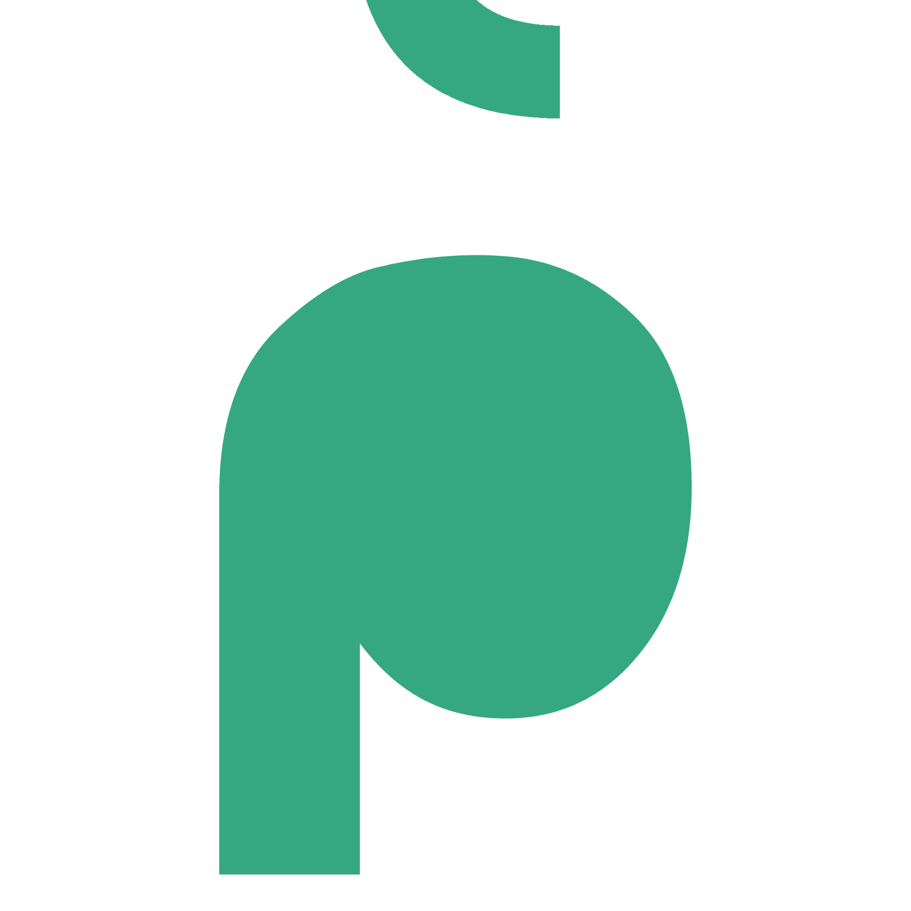
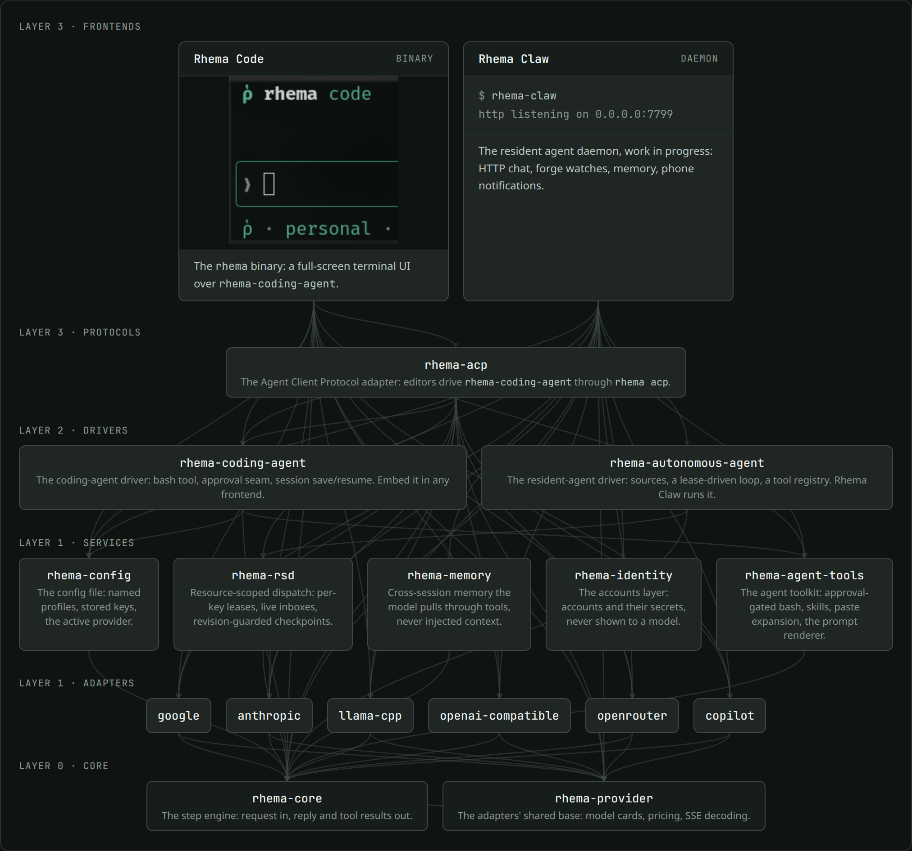
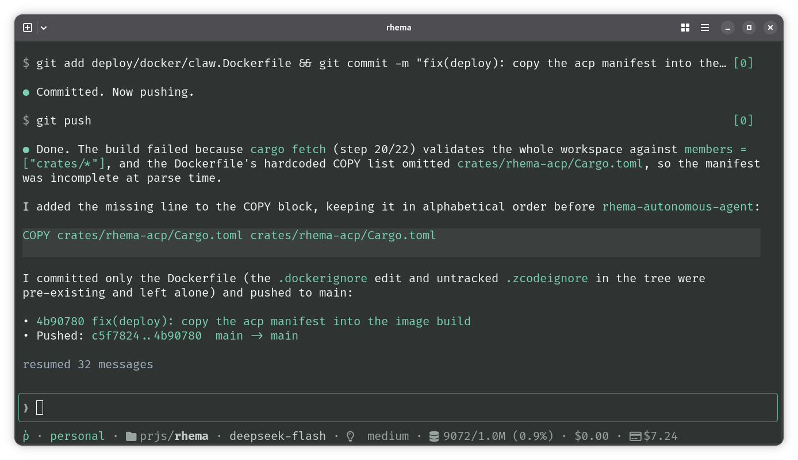

<div align="center">
<b>ῥῆμα, "the spoken word": words that do things.</b>
</div>

<br>

<div align="center">


<br>

<a href="https://rhema.rs">rhema.rs</a>
</div>

<br>

<h1 align="center">Rhema</h1>

<br>

Rhema is a small, embeddable agent framework in Rust.

It consists of multiple components, going from `rhema-code`, a terminal-based coding agent frontend, down to `rhema-core`, a simple library allowing step-based interactions with LLMs.

## Components



Each crate under `crates/` has its own README with its scope and usage; the workspace manifest lists the members.

### Rhema Code (Terminal UI)



Get Rhema Code (Linux, macOS, and Windows):
```
curl -fsSL https://get.rhema.rs/code | sh                  # Linux, macOS, git bash
irm https://get.rhema.rs/code.ps1 | iex                    # Windows PowerShell
```

On Windows, the agent's shell commands run through Git Bash. Install
[Git for Windows](https://git-scm.com/download/win) first.

After that, `rhema update` installs the channel's newest release. The TUI
runs the same check at every start and names a newer release under its
banner; the Update page of `/settings` and `/update` install it without
leaving the terminal.

See <a href="./crates/rhema-code/README.md">Rhema Code README.md</a> for more.

### Rhema Claw

Still work in progress.
Rhema Claw is the resident tier of the framework: a claw-shaped daemon
that watches forges and calendar feeds, dispatches work to its agents,
and serves chat over HTTP, with a web UI and an Android
client talking to it. It lives in its own repository:
<https://git.vhaudiquet.fr/vhaudiquet/rhema-claw>.

## rhema-host-agent

The host agent is the driver assembly of the core: `ShellTools` as the
resolver, plus approval, skills, transcript, MCP, and subagents.

```rust
let mut agent = HostAgent::new(HostAgentConfig::new(
    AnthropicProvider::new(key),   // any ModelProvider
    "claude-sonnet-5-5",
    workspace,
    AllowAll,                      // or your Approval
))?;

let reply = agent
    .turn("fix the failing test", &mut Print /* your EventSink */)
    .await?;
```

## rhema-core

Rhema Core is the generic primitive: a provider, one `ToolResolver`, a
session, and the step boundary. `provider`, `order_tools`, and `Print`
below stand for your own implementations.

### A whole turn

```rust
let mut agent = Agent::builder()
    .provider(provider)            // any ModelProvider
    .resolver(order_tools)         // your ToolResolver: check_stock, ...
    .system("You fulfill orders.")
    .model("model-id")
    .build()?;

let mut session = Session::default();
let output = agent
    .turn("can we fulfill an order of 8 units of SKU-42?",
          &mut session, &mut Print, &ToolContext::default())
    .await?;
```

`turn` owns the loop: run the model, execute the tools it asks for, send
the results back, until it answers.

### One step

```rust
let mut session = Session::default();
session.history.push(Message::user("can we fulfill an order of 8 units of SKU-42?"));

let step = agent.step(&mut session, &mut Print, &ToolContext::default()).await?;

// The model asked for a tool; the engine ran it. The next step sends the result back.
if step.output.stop_reason == StopReason::ToolUse {
    let reply = agent.step(&mut session, &mut Print, &ToolContext::default()).await?;
}
```

`step` is the primitive: one exchange, never a loop. You own the loop,
so you can persist, cancel, or steer between rounds.

Offline demo with zero network (the mock replays a scripted exchange):

```sh
cargo run -p rhema-core --features mock --example step_demo
```
