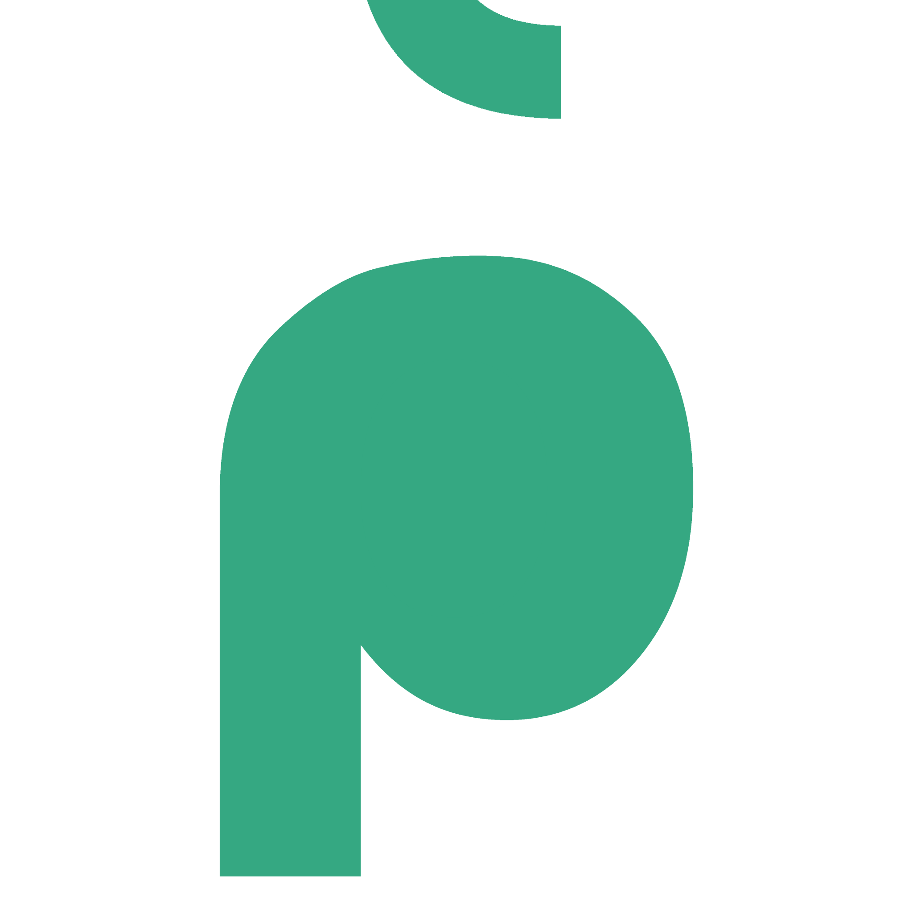
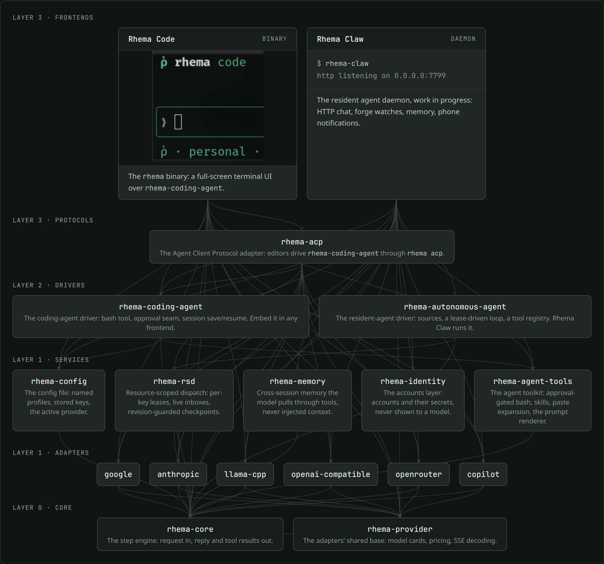
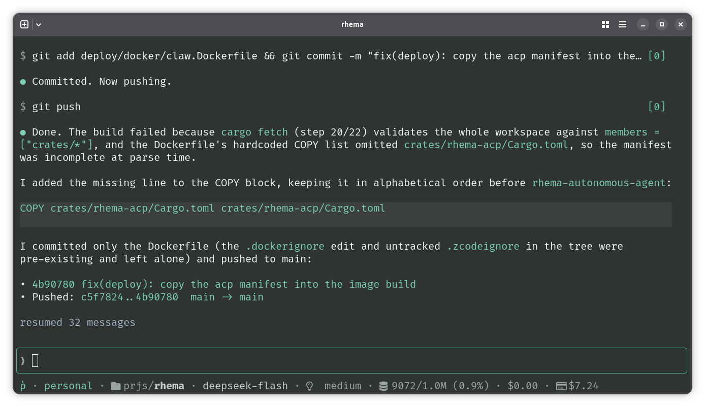

# Rhema

<div align="center">
<b>ῥῆμα, "the spoken word": words that do things.</b>
</div>

<br>

<div align="center">
<a href="https://rhema.rs">


<br>

rhema.rs
</a>
</div>

<br>

Rhema is a small, embeddable agent framework in Rust.

It consists of multiple components, going from `rhema-code`, a terminal-based coding agent frontend, down to `rhema-core`, a simple library allowing step-based interactions with LLMs.

## Components



### Rhema Code (Terminal UI)



Get Rhema Code: 
```
curl -fsSL https://get.rhema.rs/code | sh
```

See <a href="./crates/rhema-code/README.md">Rhema Code README.md</a> for more.

### Rhema Claw

Still Work-In-Progress.
See [Rhema Claw README.md](./crates/rhema-claw/README.md) for more.

### All crates

| Crate | What it does |
|---|---|
| `rhema-core` | The step engine. `Agent::step` runs one exchange with a model over a caller-owned, serializable `Session`, and never loops. Around it: the `ModelProvider`, `ToolResolver`, and `EventSink` seams, `run_turn`, a scripted `MockProvider` behind the `mock` feature, and commit-before-execute (`CommitHook`, per-tool `ReplaySafety`) so a crash inside a tool call leaves a resumable intent |
| `rhema-provider` | Shared base for the adapters: the `ModelCard` catalog row, `Pricing`, the SSE decoder, the `InteractiveLogin` flow seam, and the `Retrying` decorator that re-issues transient model failures with backoff |
| `rhema-provider-google` | Gemini adapter: streaming SSE, native tool calling, live model listing |
| `rhema-provider-anthropic` | Anthropic Messages adapter: streaming SSE, native tool use, live model listing; also serves Anthropic-compatible routes (Z.ai's GLM Coding Plan) by base override and bearer auth |
| `rhema-provider-openai-compatible` | Any OpenAI-compatible chat-completions server (OpenAI, vLLM, LM Studio): streaming, live listing |
| `rhema-provider-openrouter` | OpenRouter adapter: the text-chat catalog with per-model pricing and context lengths |
| `rhema-provider-llama-cpp` | llama.cpp `llama-server` adapter: streaming chat completions, optional bearer key |
| `rhema-provider-copilot` | GitHub Copilot adapter: the OpenAI-shaped proxy, driven by a device-flow OAuth token |
| `rhema-config` | The XDG config file: named profiles of provider instances, stored keys, the active pair, the last-used model |
| `rhema-rsd` | Resource-scoped dispatch: at most one live handler per resource key, a live inbox delivered mid-run, revision-guarded checkpoints, leases with TTL and crash recovery |
| `rhema-memory` | Cross-session memory: one record per fact behind a `MemoryStore` contract, surfaced as `memory_*` tools the model calls itself |
| `rhema-identity` | Accounts: one record per external identity, each holding one write-only secret behind a use-never-read contract |
| `rhema-autonomous-agent` | The resident-agent core tier: model-free `Source` detection, the lease-driven `Driver` loop, allowlist-cut tool resolvers, and `SessionContext::commit_hook`, which binds a run's lease to the engine's commit hook |
| `rhema-coding-agent` | The coding-agent driver: one approval-gated `bash` tool, the `Approval` seam, session save/resume, and revive-on-resume for calls a crash left unanswered; its system prompt assembled from the editable SYSTEM.md template, tools and skills rendered in |
| `rhema-acp` | The coding agent as an Agent Client Protocol subprocess, so ACP editors (T3 Code, Zed, JetBrains, Neovim, Emacs, VS Code) drive it without a per-editor plugin |
| `rhema-code` | The `rhema` binary: the full-screen terminal UI, `rhema run` for the pipeable one-shot, `rhema acp` for editors, `rhema system edit/show/restore` for the prompt the agent works from |
| `rhema-claw` | The resident agent daemon (work in progress): one SQLite store of sessions, forge threads answered with coding-agent turns, chat over HTTP |

## rhema-core

Here is a small example code using `rhema-core` to interact with a model:

```rust
use std::sync::Arc;

use rhema_core::{
    async_trait, run_turn, Agent, AgentError, ChatParams, Content, Event,
    EventSink, Message, MockProvider, ModelOutput, Role, Session, StopReason,
    ToolCall, ToolContext, ToolResolver, ToolResult, ToolSpec, Usage,
};

struct Echo;

#[async_trait]
impl ToolResolver for Echo {
    fn specs(&self) -> Vec<ToolSpec> {
        vec![ToolSpec::new("echo", "Echo the input back", serde_json::json!({}))]
    }
    async fn resolve(&self, call: ToolCall, _ctx: &ToolContext) -> ToolResult {
        ToolResult::success(&call.id, call.args.to_string())
    }
}

// A sink that prints every event; replace with your UI/log/channel.
struct Print;
impl EventSink for Print {
    fn emit(&mut self, event: Event<'_>) { println!("{event:?}"); }
}

// Any ModelProvider implementation; MockProvider is the scripted offline
// one (feature `mock`). A real HTTP adapter is a rhema-provider-* crate.
fn provider() -> Arc<dyn rhema_core::ModelProvider> {
    Arc::new(MockProvider::new(vec![ModelOutput {
        message: Message {
            role: Role::Assistant,
            content: vec![Content::Text("done".into())],
        },
        stop_reason: StopReason::EndTurn,
        usage: Usage::default(),
    }]))
}

#[tokio::main]
async fn main() -> Result<(), AgentError> {
    let mut agent = Agent::builder()
        .provider(provider())
        .resolver(Arc::new(Echo))
        .system("you are a helpful agent")
        .params(ChatParams::new("model-id")) // any id your provider accepts; the mock ignores it
        .build()?;
    let mut session = Session::default();
    let ctx = ToolContext::default();
    let input = Message::text(Role::User, "run the echo tool, then summarize");
    let output = run_turn(&mut agent, &mut session, input, &mut Print, &ctx, 8).await?;
    println!("{output:?}");
    Ok(())
}
```

Offline demo with zero network (the mock replays a scripted exchange):

```sh
cargo run -p rhema-core --features mock --example step_demo
```
