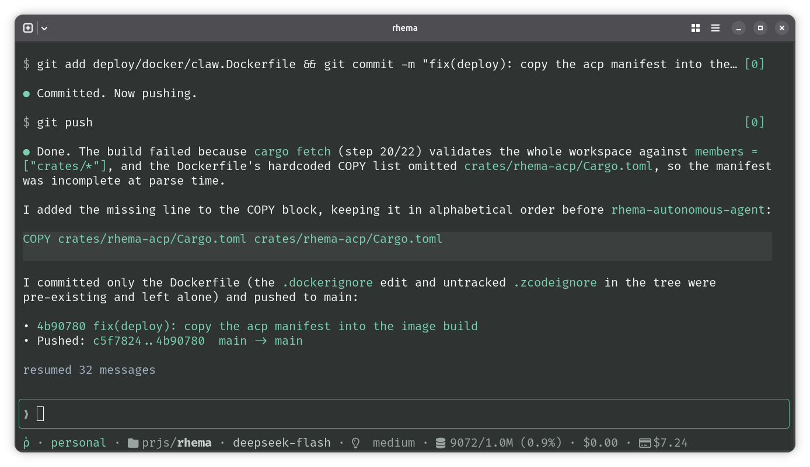

# Rhema Code

```
curl -fsSL https://get.rhema.rs/code | sh
rhema
```

Rhema Code is a terminal-based coding agent, built on the Rhema agent framework.


<div align="center"><em>The Rhema Code TUI.</em></div>

## Features

### Onboarding

The first start (no config yet, or a wizard left unfinished) runs a setup wizard: a welcome step introduces it, and the rhema logo sits on a progress rail beside the steps, with a check on the ones passed, a filled dot on the current one, and a hollow dot on the ones ahead. After the welcome the wizard asks for the default profile, listing the config's profiles (`personal` and `work` on a fresh setup) with an add row for a new name; the pick becomes the profile the rest of the wizard writes to. Then come a provider login, a model pick from that login's catalog, the color palette (previewed live as the rows move), and the bundled skills' on/off switches. `rhema onboard` runs it again any time. Nothing else gates the session: a config without a model or a login still opens the chat, the footer names what is missing in red, and `/model` or `/login` is one keystroke away.

On terminals that speak the kitty graphics protocol (kitty, Ghostty) the wizard draws the logo as an image; everywhere else it falls back to the wordmark. Set `RHEMA_NO_IMAGES` to keep it text.

### Text selection

Drag with the left button over the transcript to select the text between the cell the drag started on and the cell it reached. The selected cells render reversed, and releasing the button copies the text to the system clipboard. On a terminal-only session with no desktop clipboard, the copy goes through the terminal with OSC 52. Any key, the wheel, or a fresh click clears the highlight, and a selection only covers the rows currently on screen.

### Transcript scroll

The wheel and PgUp/PgDn walk the transcript's history; scrolling back down to the tail returns to the live conversation. While the conversation runs past the viewport and you are scrolled up into the history, a rail appears in the right margin: the brighter thumb marks the part of the content on screen, and dragging the rail (or clicking anywhere on it) moves the window there. At the tail the rail is off, so the reading column stays clean by default. The rail lives in the margin the wrap already leaves free, so it never re-wraps a block, a transcript that fits its viewport draws none, and `scrollbar: false` keeps the margin bare at any scroll position.

### Pasting

Ctrl-v pastes the system clipboard: an image lands as a chip (RGBA re-encoded as PNG, up to 5 MB per image, the same limit the `see` staging refuses at), text joins the input inline or as a chip past three lines. A larger image is refused at the key with a notice naming the count and the limit. Where the terminal binds its own paste, ctrl-shift-v usually, text arrives as a bracketed paste; an image does not, terminal paste is text-only. With no desktop clipboard to connect, an ssh hop or a plain TTY, ctrl-v says so in a notice instead of staying silent, and an image rides a file: save it in the checkout and name it in the prompt, the `see` command shows it to the model.

### Prompts

What you send sits on the right in a rounded bubble, capped at three quarters of the transcript's width. A multi-line prompt keeps its breaks, and a paste or an image stays a chip inside the bubble. The bubble is a hairline frame on the page's own ground, nothing bleeds around it, and `background: native` keeps your theme's background inside it, so every terminal draws the same bubble. Where the terminal speaks the kitty graphics protocol *and* honors the text layer above a below-text image (kitty and Ghostty; WezTerm composites images over the glyphs, so there the bubble stays ink-only), the frame is backed by a card: a translucent accent tint with the same rounded corners, composited under the glyphs and the text through `z=-1` placements. The tint fills only the inner half of each frame cell, so the card is tangent to the hairline on all four sides and never overhangs it. The tint rides at the card's opacity over any ground, so it works in both background modes. `RHEMA_NO_IMAGES` forces the ink-only frame.

### Rich settings

<!-- TODO Screenshot -->

### Colors

The look and feel is machine-owned: it lives in `config.yaml`, not in flags. The `colors` key picks the palette, the setting defaults to `rhema` and cycles live from the Appearance page of `/settings`:

```yaml
colors: rhema          # rhema | aquamarine | black-and-white | dracula | catppuccin-* | nord | gruvbox | solarized | m3-you | custom
theme: dark            # dark | light, the palette's appearance
background: rhema      # rhema | native, the palette's fills, or the terminal's own background
icons: unicode         # unicode | nerd, the footer's icon flavor
cursor: default        # default | block | line | underline, the input caret's shape
scrollbar: true        # true | false, the transcript's scrollbar
m3_source: "#6750A4"   # the m3-you seed color (#RRGGBB), optional
custom:                # the custom palette's tokens (#RRGGBB), optional
  dark:
    ground: "#1E1E2E"
    accent: "#89B4FA"
    # ... every token name; anything left out reads as the rhema default
  light:
    ground: "#EFF1F5"
```

`background: native` hands the page's fills back to the terminal: panes, dialogs, and the transcript well paint nothing, so your theme's own background shows through and rhema colors only the ink (text, borders, accents, code-block markers) and the prompt bubbles' frames, the protocol card still backs the bubbles there, its translucent tint compositing over whatever ground the terminal keeps, but the page's own panels stay ink-only. The default `background: native` hands the page's fills back to the terminal; `background: rhema` paints the palette's fills, the design the palettes were drawn for. The toggle is live from the Appearance page of `/settings` (the `b` key), like the theme and icons ones.

`cursor` picks the input caret's shape: `default` leaves the terminal's cursor alone, which keeps the shape your shell left in place (a line at a prompt under shell integration), `block` asks for a steady block, `line` for a steady bar (`|`), and `underline` for a steady underscore (`_`). The choice cycles live from the Appearance page (`enter` or the `s` key) and is written back to the config. A terminal without support for DECSCUSR ignores the request and keeps its own cursor.

`scrollbar` turns the transcript's scroll rail on or off. It defaults to `true`, so the rail draws while you read back through history. Set it to `false` for a clean right margin; the wheel and PgUp/PgDn still scroll. Toggle it live from the Appearance page (`enter` or the `r` key), and the choice is written back to the config.

Every palette ships both appearances. Rhema is the design the TUI was drawn against; Aquamarine and Black-and-white restyle the same slots; Dracula maps the official colors onto them (its light side is derived, since Dracula ships no official light variant). The Catppuccin flavors (`catppuccin-frappe`, `catppuccin-macchiato`, `catppuccin-mocha`) use the official hexes in the roles their [style guide](https://github.com/catppuccin/catppuccin/blob/main/docs/style-guide.md) defines; `theme: light` reads Latte, the set's only light flavor, since the guide forbids blending flavors inside one theme. Nord, Gruvbox, and Solarized map the canonical hexes the same way (Gruvbox and Solarized ship official light sides; Nord's light side is derived, as it ships dark only). M3 You generates a [Material 3](https://m3.material.io/styles/color/system/overview) tonal-spot scheme from a seed color: set `m3_source` to a color picked from your wallpaper (a terminal cannot see it), and the whole UI, grounds, text, accent, status colors, derives from it. Without a seed it uses Material's baseline purple.

`custom` reads every color from the config, which is the hook for external generators: a wallpaper watcher or scheme tool (pywal, [matugen](https://github.com/InioX/matugen), a shell one-liner) computes a scheme and writes the `custom` block, and rhema picks it up on the next start. Tokens are named after the design slots (`ground`, `surface`, `text`, `accent`, ..., all seventeen); anything left out, or written in a form that is not a `#RRGGBB` color, reads as the rhema default for that slot, so a file overriding two tokens is still a valid palette. An appearance the file does not give reads as the other one's full scheme, so a generator writing only `dark` still paints on light terminals.

### Customizable, scriptable system-prompt

```
rhema system edit
```

The above command lets you edit the system prompt in your `$EDITOR`. It uses a Jinja template (`minijinja`), so you can customize the skills part, the tool part, etc.

`rhema system show` prints the exact prompt the next turn in this workspace would send, sections included (the environment report, your `USER.md`), resolved against the stored profile's sandbox kind, rendered as styled markdown on a terminal, byte-exact when piped.

### Environment report & USER.md

Every session's system prompt carries an environment report: the OS, date, model, harness, shell, the workspace's git branch, and which of the coding tools are installed (defined in `crates/rhema-host-agent/environment.yaml`, the file holds every text the report renders, as templates). When ripgrep answers, the report says so. Search with `rg` (it respects `.gitignore`; `-uu` also searches ignored files). In a sandbox session (`docker`, `ssh`, `http`) the report claims no host facts; it names the sandbox kind and its workspace, and tells the agent to probe the machine itself. The report is stamped once **at conversation start** and carried in the session. Resumes, model-less rebuilds, and thinking changes reuse the same bytes, so the prompt prefix stays byte-identical and the provider's prompt cache holds; a sandbox or model switch re-reports, because the machine or the model is a fact that changed.

What the probe finds missing shows up for you, not in the prompt: the terminal UI shows a dim `missing tools: fd, jq, ask the agent to install them` strip above the footer until the conversation starts, and `rhema run` prints the same note on stderr. The install itself stays conversational, ask the agent, and it detects your package manager and installs through the approval gate, where a password-prompting `sudo` is a conversation rather than a keystroke. No install commands ride the prompt: which package holds a tool is the package manager's question, answered live when you ask, not a machine-dependent claim to memorize up front.

Your own preferences ride the same prompt: create `USER.md` in the config directory (`~/.config/rhema/USER.md`) and its contents render verbatim into every session's system prompt, tone, conventions, anything you want the agent to always know about you. A missing or blank file renders nothing.

### ACP (Agent Client Protocol) support

You can use Rhema Code directly in your editor or orchestrator, using the Agent Client Protocol.

```sh
rhema acp
```

An editor launches the above command and directly talks ACP with Rhema Code.

### Profiles

Rhema Code ships with two default profiles `work` and `personal` that let you manage your different subscription contexts. Each profile can store any amount of subscription instances. The profile you choose in a folder is remembered there, and its subfolders inherit it until one of them chooses its own.

The add dialog opens on three groups: Subscriptions, API / Pay-as-you-go, and Local/Custom. Each group lists only its providers, so the subscriptions stay apart from metered keys and a local server. The API and Local/Custom groups both offer a Custom OpenAI-compatible API row, which asks for the endpoint's base URL and a key; hosted providers use their own fixed routes and ask only for the key.

Login keys are stored in an encrypted file under the config directory (`secrets.age`), with its generated key under the state directory (`secrets.key`), and the config file holds only an opaque reference to the entry. The split means a config directory copied without the state root carries no readable credential. The write path has no OS keyring and no passphrase prompt, so this works the same on a desktop, over SSH, and in a container; it protects against another user and an accidental read, not against a process running as you. On the first start after upgrading from the old keyring backend, a local session reads the old OS keyring once and copies every config `secret_ref` the encrypted store is missing, leaving the old entries in place; an SSH session skips that read, because the keyring is what does not answer there. Run Rhema locally once, or set `RHEMA_IMPORT_KEYRING=1` when the keyring is reachable over SSH; `RHEMA_IMPORT_KEYRING=0` skips the read everywhere. If the store refuses, the key stays in the file itself, the historical fallback. If `secrets.key` is lost, the ciphertext cannot be opened; delete `secrets.age` and log in again. Logging in again replaces the entry; forgetting the instance deletes it. Environment variables still outrank everything stored.

### ChatGPT subscriptions

Run `/login`, choose **ChatGPT**, and sign in through OpenAI's browser OAuth flow, with PKCE and a loopback callback on port 1455 (1457 when 1455 is taken). The flow opens the browser and shows the link's host with two buttons: enter (or `o`) opens the link in the default browser, and `c` copies the full URL to the clipboard, so a long authorization query never has to be selected by hand. The callback captures the code, exchanges it, and stores the credential like any other login. The browser must reach the machine running rhema: over SSH, forward the callback port first with `ssh -L 1455:localhost:1455`. On a headless box, copy the link with `c` and open it on another machine with the same forward in place.

The stored credential is the token JSON the flow returns (access, refresh, account id, email, plan, expiry). `CHATGPT_ACCESS_TOKEN` accepts a bare access token for scripted setups. Refreshed tokens live in memory for the running process; if OpenAI rotates the stored refresh token, sign in again.

Turns run on the Codex Responses backend (`chatgpt.com/backend-api/codex`), and the model picker lists the subscription's live catalog. The adapter sends `originator: rhema`, not another client's name.

### Mistral API and Vibe subscriptions

The add dialog offers **Mistral API** for a pay-as-you-go or plan API key from `console.mistral.ai`, and **Mistral Vibe** for a Vibe subscription. Vibe's row runs the console's browser sign-in with PKCE: it opens `codestral/cli/authenticate`, polls until the browser finishes, and exchanges the completion token for an API key scoped to the signed-in workspace. Either way the stored credential is an ordinary `MISTRAL_API_KEY`-shaped key, and turns run on `api.mistral.ai/v1`: the Responses API (`POST /v1/responses`, documented beside chat completions) by default, or the older chat-completions dialect the instance's `api: chat` pins back in.

`MISTRAL_API_KEY` serves the API row for scripted setups and outranks the stored key. `MISTRAL_VIBE_API_KEY` is the Vibe row's environment tier. A stored instance may name a base URL for a dedicated Mistral deployment; the picker lists the account's chat models with their context windows, vision capability, and published per-MTok prices.

### Saved sessions

Every conversation checkpoints to disk as turns stream, through the same store ACP and `--save` use (`rhema-session-store-file`): one bare-JSON `Session` per file, written to a private temp file, fsynced, and renamed over the previous checkpoint. A crash mid-turn leaves the last committed boundary, never a half file. `/resume` lists the workspace's saved sessions from `<cache>/rhema/sessions/<encoded-workspace>/`, newest first, and shows each one's opening prompt, age and size. `ctrl-a` widens the list to every workspace, naming each row's workspace on its metadata line; `ctrl-a` again narrows it back.

### Skills, sessions, etc.

Skills are folders holding a `SKILL.md` whose frontmatter `description` is the trigger the agent sees; an optional `license` line is shown (dimmed, under the description) in the Skills page of `/settings` and in the onboarding wizard. Drop one into `.rhema/skills/` in your workspace or `~/.config/rhema/skills/` for every workspace; project shadows global.

Rhema also reads the cross-agent directories `.agents/skills/` (in the workspace) and `~/.agents/skills/`. Thus, skills that you install with the [`skills` CLI](https://skills.sh) are available in rhema:

```
npx skills add <owner/repo>        # project: .agents/skills/
npx skills add <owner/repo> -g     # global: ~/.agents/skills/
```

A skill in a rhema directory hides a skill with the same name in an `.agents` directory. Rhema ignores a skill folder that is a symlink.

Rhema bundles two skills, `commit-message` and `unslop`, and seeds them into the global skills directory on start. A bundled skill you have edited is left alone, and a folder of the same name shadows it like any other. Toggle skills on and off from the Skills page (`enter`/`space`) or at onboarding; a switched-off skill's trigger leaves the system prompt but keeps its row, greyed, in the lists.

MCP servers live in the sandbox, not the host profile. The settings page edits `~/.config/rhema/mcp/config.json` inside the sandbox (the shared runtime root's `mcp/<target>/config.json` for mounted backends), and the prompt's `mcp` section is the standalone `mcp prompt` output. The model calls `mcp <server> --list`, `mcp <server> <tool> --flag value`, and the rest; no host bridge and no `rhema mcp` subcommand.

### Subagents

Drop a folder holding a `SUBAGENT.md` into `.rhema/subagents/` in your workspace (or `~/.config/rhema/subagents/` for every workspace; project shadows global), and the agent gains one `subagent` tool. The frontmatter `description` is the trigger the agent sees, the body is the subagent's own system prompt, and `model` / `max_steps` are optional:

```markdown
---
description: Reviews a diff for correctness. Use for a second opinion before committing.
model: anthropic/claude-haiku
max_steps: 128
---

You are a code reviewer. ...
```

The agent always has one subagent with nothing defined: `general-purpose`, a fresh agent for one self-contained task, on the parent's model and step budget. A definition folder named `general-purpose` shadows it, project over global, like any other name.

When the agent delegates, the subagent runs its own conversation with the same workspace tools in the same workspace, its report lands in the conversation as the tool's result, and the status strip pins one live line for it while it works. Inner commands ask for approval exactly like the main agent's do, and the subagent's requests are bounded by the same transcript the main session uses. A long call folds its old history into the compaction block instead of re-sending a growing prompt. A subagent never spawns further subagents.

While a subagent works, the status strip pins a live line under the spinner, the robot badge, the subagent's name, its phase (`thinking`, `running`, `writing output`), the context its current model call carries against its model's window, the cost of everything its calls have spent so far, and its age. Its transcript row reads as delegation too: the robot badge, then the subagent and the task's first line. With the Nerd Font icon flavor the badge is the robot glyph; the plain flavor marks it with `@`.

### Decision models

The agent's shell has a `decide` function for the judgments a turn needs before it acts: is this message urgent, which team handles it, how severe is the bug. A decision model (TypeSafe's Jev, Cloudflare's Clef, or any of the forty-odd System One models OpenRouter routes to) answers such typed questions with calibrated probabilities in one pass and generates no text, so a question costs one short command instead of a reasoning turn. Three kinds: `noul` (the probability a yes/no statement is true), `choice` (one of the options you name, with a probability per option), `score` (a position on an ordered rubric):

```
decide noul "my order never arrived, I want a refund now" "Does the customer ask for a person?"
decide choice "my order never arrived" "Which team handles this" billing="Payments and refunds" logistics="Shipping"
decide score "checkout has failed for every customer for an hour" "Customer impact" None One-order Many-orders
decide < request.json          # several questions over one state, or a structured state
```

Each answer comes back as one line: the pick, the distribution in brackets, the confidence where the model reports one. `--json` (before the verb) prints the raw response. The function appears only when the profile has a provider; the prompt's `Decision models` section documents it then.

A profile holds any number of named decision instances under `decision:` and names the one `decide` asks (`instance`; unset, the first). There is no fallback from one vendor to another, and no flag picks another per call. Keys follow the same tiers as every other key (environment, secret store, stored literal):

```yaml
profiles:
  personal:
    decision:
      instance: jev                 # the default among instances
      instances:
        jev:
          provider: jev
          api_key: ...                # or secret_ref from the secret store
          model: jev-latest           # or jev-preview, a pinned version
        clef:
          provider: clef
          api_key: ...                # a Workers AI API token
          account_id: ...             # the account the model runs on
          model: clef-flash           # clef (27B, default) or clef-flash (9B)
        router:
          provider: openrouter         # the aggregator: one key to Jev, Clef and 40-odd others
          api_key: ...
          model: typesafe/jev-1.14     # any slug its catalog lists under output_modalities=decisions
```

A `base_url` on a Jev instance points the call at any server that speaks the same `/v1/systemone` wire (Ollaya, vLLM, SGLang, llama.cpp serving Clef or another open decision model). Without a `decision` section the environment serves: `TYPESAFE_API_KEY`, `CLOUDFLARE_AUTH_TOKEN` plus `CLOUDFLARE_ACCOUNT_ID`, or `OPENROUTER_API_KEY`, the first that resolves. A sandboxed session sends `decide` to a per-session host endpoint, so the keys stay on the host; HTTP sandboxes have no route to it yet. `specs/rhema-decision.md` is the design.

The **Decision models** page of `/settings` edits this section: the add row's dialog picks the kind (Jev, Clef, OpenRouter, or a custom Jev endpoint, which asks for the server's URL too), names the instance, and takes the key, which goes to the secret store as the Providers page's do; Clef also asks for its account id. Enter on a row makes it the default, `d` removes it with its secret-store entry. The model stays a file matter: each row shows what a blank asks, the kind's default.

### Where bash runs

The `bash` tool can run somewhere other than your host. The profile's `sandbox.kind` in `config.yaml` picks where, and `RHEMA_SANDBOX` overrides the stored kind the same way `RHEMA_PROVIDER` does. Six kinds:

- `local` (the default): commands run as your processes in the workspace, exactly as they always have.
- `docker`: commands run in a container with the workspace bind-mounted at its own path. rhema stands the container up on first use and keeps it between runs.
- `lxd`: commands run in an LXD instance, a container with the workspace disk-mounted 1:1, or a `--vm` with the tree attached, named by `sandbox.instance`, stood up on first use and kept between runs.
- `ecrou`: commands run in a microVM that boots for the length of the command and dies after it, the workspace shared in at its own path. One machine per command, nothing persists between them, and the isolation is a real kernel per command.
- `ssh`: commands run on a remote box named by `sandbox.host`, with nothing installed on the far end.
- `http`: commands run behind a `rhema-sandboxd` daemon named by `sandbox.url`, with an optional token.

Your `SYSTEM.md` is copied into the sandbox at startup, and in the mount postures (`docker`, `lxd` containers) the discovered skills ride read-only mounts, the global skills directory alongside the workspace, so a skill you edit mid-session is the new text the next read sees; the seeded postures (`ssh`, `http`, `lxd` vms, `ecrou`) copy the skills in instead. Your keys, profiles, and session history stay on your host in every mode. On safety, plainly: `local` and the mount postures are process hygiene, not security boundaries. When the last rhema session using a rhema-created sandbox instance exits, the instance is stopped; an instance you named yourself in the profile is never stopped out from under you.

### Program status (OSC 7501)

Rhema Code reports what it is doing to the terminal, following [Mitchell Hashimoto's program status protocol](https://mitchellh.com/writing/program-status-osc7501): `working` (naming the current tool; no progress percentage, a turn's length is nobody's guess) while a turn runs, `blocked` (permission or auth) when it needs you, `idle` at the prompt, and `done` or `error` when a `rhema run` one-shot finishes, so supporting terminals (Ghostty, and terminal UIs built on libghostty) can mark tab headers, session pickers, and agentic inboxes without scraping the screen. Terminals without support ignore the sequence; piped output stays byte-exact.

## Documentation

- `rhema onboard`: re-run the first-run wizard (profile, provider, model, colors, skills).
- `/model [provider/model]`: pick the model the profile runs. With no argument (or Ctrl-P) it opens the settings' Models page; with one it switches straight to it.
- `/switch [provider/model]`: run this session on another model without writing the choice into the profile; the next launch returns to the stored model. With no argument it opens a picker over the catalog, and the pick rides the session alone.
- `/settings`: everything the wizard sets, plus profiles, appearance, subagents, usage, and about. The Models page lists the catalog as a table under the page's own cursor — model, price in and out, capabilities, and context, each under its own bold column title — typing filters it (the column titles stay, and a filter that matches nothing says `no match` in the rows' own column), Enter (or a click) makes the pick the profile's model, and the row in use says so; the Providers page lists the logins; the Profiles page adds, removes, and switches profiles and cycles each one's name color; the Skills page toggles skills on and off and shows each one's license.
- `/update`: check the distribution channel and install the newest release in place. Rhema Code runs the same check at every start and puts a line under the banner when a newer release exists. The `/settings` sidebar lists the Update page only while one does, beside this build's version and the channel's, and its Update now row runs the same install; `rhema update` runs it outside the TUI.

## About

```
MIT License
Copyright (c) 2026 Valentin Haudiquet
```