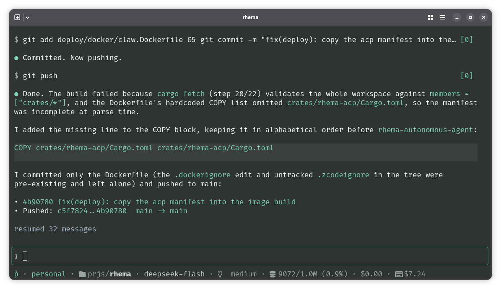

# Rhema Code

```
curl -fsSL https://get.rhema.rs/code | sh
rhema
```

Rhema Code is a terminal-based coding agent, built on the Rhema agent framework.


<div align="center"><em>The Rhema Code TUI.</em></div>

## Features

### Rich settings

<!-- TODO Screenshot -->

### Colors

The look and feel is machine-owned: it lives in `config.yaml`, not in flags. The `colors` key picks the palette — the setting defaults to `rhema` and cycles live from the Appearance page of `/settings`:

```yaml
colors: rhema          # rhema | aquamarine | black-and-white | dracula | catppuccin-* | nord | gruvbox | solarized | m3-you | custom
theme: dark            # dark | light — the palette's appearance
icons: unicode         # unicode | nerd — the footer's icon flavor
m3_source: "#6750A4"   # the m3-you seed color (#RRGGBB), optional
custom:                # the custom palette's tokens (#RRGGBB), optional
  dark:
    ground: "#1E1E2E"
    accent: "#89B4FA"
    # ... every token name; anything left out reads as the rhema default
  light:
    ground: "#EFF1F5"
```

Every palette ships both appearances. Rhema is the design the TUI was drawn against; Aquamarine and Black-and-white restyle the same slots; Dracula maps the official colors onto them (its light side is derived, since Dracula ships no official light variant). The Catppuccin flavors (`catppuccin-frappe`, `catppuccin-macchiato`, `catppuccin-mocha`) use the official hexes in the roles their [style guide](https://github.com/catppuccin/catppuccin/blob/main/docs/style-guide.md) defines; `theme: light` reads Latte, the set's only light flavor, since the guide forbids blending flavors inside one theme. Nord, Gruvbox, and Solarized map the canonical hexes the same way (Gruvbox and Solarized ship official light sides; Nord's light side is derived, as it ships dark only). M3 You generates a [Material 3](https://m3.material.io/styles/color/system/overview) tonal-spot scheme from a seed color: set `m3_source` to a color picked from your wallpaper (a terminal cannot see it), and the whole UI — grounds, text, accent, status colors — derives from it. Without a seed it uses Material's baseline purple.

`custom` reads every color from the config, which is the hook for external generators: a wallpaper watcher or scheme tool (pywal, [matugen](https://github.com/InioX/matugen), a shell one-liner) computes a scheme and writes the `custom` block, and rhema picks it up on the next start. Tokens are named after the design slots (`ground`, `surface`, `text`, `accent`, ... — all seventeen); anything left out, or written in a form that is not a `#RRGGBB` color, reads as the rhema default for that slot, so a file overriding two tokens is still a valid palette. An appearance the file does not give reads as the other one's full scheme, so a generator writing only `dark` still paints on light terminals.

### Customizable, scriptable system-prompt

```
rhema system edit
```

The above command allows you to edit the system prompt in your `$EDITOR`. It uses a Jinja template (`minijinja`), so you can customize the skills part, the tool part, etc.

`rhema system show` prints the exact prompt the next turn in this workspace would send — sections included (the environment report, your `USER.md`), resolved against the stored profile's sandbox kind — rendered as styled markdown on a terminal, byte-exact when piped.

### Environment report & USER.md

Every session's system prompt carries an environment report: the OS, date, model, harness, shell, the workspace's git branch, and which of the coding tools are installed (defined in `crates/rhema-coding-agent/environment.yaml` — the file holds every text the report renders, as templates). When ripgrep answers, the report says so — search with `rg` (it respects `.gitignore`; `-uu` also searches ignored files). In a sandbox session (`docker`, `ssh`, `http`) the report claims no host facts; it names the sandbox kind and its workspace, and tells the agent to probe the machine itself. The report is stamped once **at conversation start** and carried in the session — resumes, model-less rebuilds, and thinking changes reuse the same bytes, so the prompt prefix stays byte-identical and the provider's prompt cache holds; a sandbox or model switch re-reports, because the machine or the model is a fact that changed.

Your own preferences ride the same prompt: create `USER.md` in the config directory (`~/.config/rhema/USER.md`) and its contents render verbatim into every session's system prompt — tone, conventions, anything you want the agent to always know about you. A missing or blank file renders nothing.

### ACP (Agent Client Protocol) support

You can use Rhema Code directly in your editor or orchestrator, using the Agent Client Protocol.

```sh
rhema acp
```

An editor launches the above command and directly talks ACP with Rhema Code.

### Profiles

Rhema Code ships with two default profiles `work` and `personal` that allows you to manage your different subscription contexts. Each profile can store any amount of subscription instances.

Login keys are stored in your system keychain (macOS Keychain, Windows Credential Manager, or the freedesktop Secret Service) whenever one is reachable — the config file then holds only an opaque reference to the entry — and fall back to the file itself on machines without one (containers, headless boxes). Logging in again replaces the keychain entry; forgetting the instance deletes it. Environment variables still outrank everything stored.

### Skills, sessions, etc.

Regular coding agent features are supported, while maintaining a simplicity balance. Right now, no MCPs.

### Subagents

Drop a folder holding a `SUBAGENT.md` into `.rhema/subagents/` in your workspace (or `~/.config/rhema/subagents/` for every workspace; project shadows global), and the agent gains one `subagent` tool. The frontmatter `description` is the trigger the agent sees, the body is the subagent's own system prompt, and `model` / `max_steps` are optional:

```markdown
---
description: Reviews a diff for correctness. Use for a second opinion before committing.
model: anthropic/claude-haiku
max_steps: 128
---

You are a code reviewer. ...
```

The agent always has one subagent with nothing defined: `general-purpose`, a fresh agent for one self-contained task, on the parent's model and step budget. A definition folder named `general-purpose` shadows it — project over global, like any other name.

When the agent delegates, the subagent runs its own conversation with the same workspace tools in the same workspace, its report lands in the conversation as the tool's result, and the status strip pins one live line for it while it works. Inner commands ask for approval exactly like the main agent's do, and the subagent's requests are bounded by the same transcript the main session uses — a long call folds its old history into the compaction block instead of re-sending a growing prompt. A subagent never spawns further subagents.

While a subagent works, the status strip pins a live line under the spinner — the robot badge, the subagent's name, its phase (`thinking`, `running`, `writing output`), the context its current model call carries against its model's window, the cost of everything its calls have spent so far, and its age. Its transcript row reads as delegation too: the robot badge, then the subagent and the task's first line. With the Nerd Font icon flavor the badge is the robot glyph; the plain flavor marks it with `@`.

### Where bash runs

The `bash` tool can run somewhere other than your host. The profile's `sandbox.kind` in `config.yaml` picks where, and `RHEMA_SANDBOX` overrides the stored kind the same way `RHEMA_PROVIDER` does. Four kinds:

- `local` (the default): commands run as your processes in the workspace, exactly as they always have.
- `docker`: commands run in a container with the workspace bind-mounted at its own path. rhema stands the container up on first use and keeps it between runs.
- `ssh`: commands run on a remote box named by `sandbox.host`, with nothing installed on the far end.
- `http`: commands run behind a `rhema-sandboxd` daemon named by `sandbox.url`, with an optional token.

The discovered skills and your `SYSTEM.md` are copied into the sandbox at startup; your keys, profiles, and session history stay on your host in every mode. On safety, plainly: `local` and the mount postures are process hygiene, not security boundaries.

### Program status (OSC 7501)

Rhema Code reports what it is doing to the terminal, following [Mitchell Hashimoto's program status protocol](https://mitchellh.com/writing/program-status-osc7501): `working` (with step progress and the current tool) while a turn runs, `blocked` (permission or auth) when it needs you, `idle` at the prompt, and `done` or `error` when a `rhema run` one-shot finishes — so supporting terminals (Ghostty, and terminal UIs built on libghostty) can mark tab headers, session pickers, and agentic inboxes without scraping the screen. Terminals without support ignore the sequence; piped output stays byte-exact.

## Documentation

## About

```
MIT License
Copyright (c) 2026 Valentin Haudiquet
```